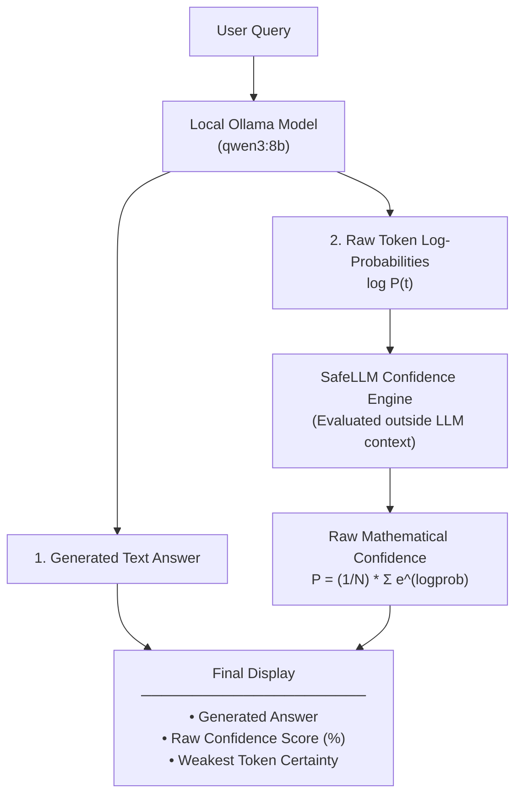

# SafeLLM 🛡️

A lightweight AI safety tool that computes and displays the **raw, tamper-proof mathematical confidence score** underneath every LLM response using Ollama's neural network token log-probabilities.

---

## 🎯 The Core Idea

Standard LLMs are notoriously overconfident when asked to self-evaluate:
- Verbalized confidence (*"I am 99% sure"*) is just generated text that can be hallucinated, sycophantic, or manipulated.
- **SafeLLM** bypasses the model's text generation and extracts the exact probabilities directly from the transformer's softmax distribution ($P(t) = e^{\text{logprob}}$).
- The model **cannot see or tamper with this score** because it is calculated entirely outside of the model's generation context.
- **No arbitrary thresholds or censorship**: SafeLLM simply presents the raw, objective certainty percentage under every answer.

---

## 🏗️ Architecture



---

## 🚀 Quickstart

1. Ensure Ollama is running locally:
   ```bash
   ollama serve
   ```
2. Run SafeLLM:
   ```bash
   python safellm.py
   ```
