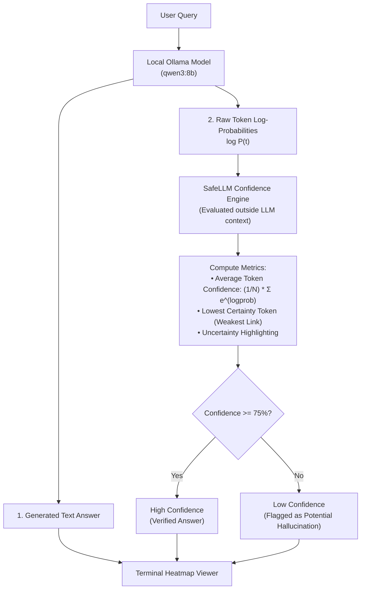

# SafeLLM 

AI safety framework that calculates **mathematical confidence scores** directly from Ollama's neural network token log-probabilities.

---

## The Problem

Standard LLMs are notoriously overconfident:
- When prompted *"How sure are you?"*, a model will claim 99% certainty even while completely hallucinating.
- Verbalized confidence is just generated text—it can be manipulated, hallucinated, or jailbroken.

**SafeLLM's Solution:** Compute true confidence at the **neural network probability level**. The model produces text, but an external evaluator calculates the exact token probabilities $P(t) = e^{\text{logprob}}$. The model cannot see or game this calculation.

---

## Architecture



---

## Quickstart

1. Ensure Ollama is running:
   ```bash
   ollama serve
   ```
2. Run SafeLLM:
   ```bash
   python safellm.py
   ```
